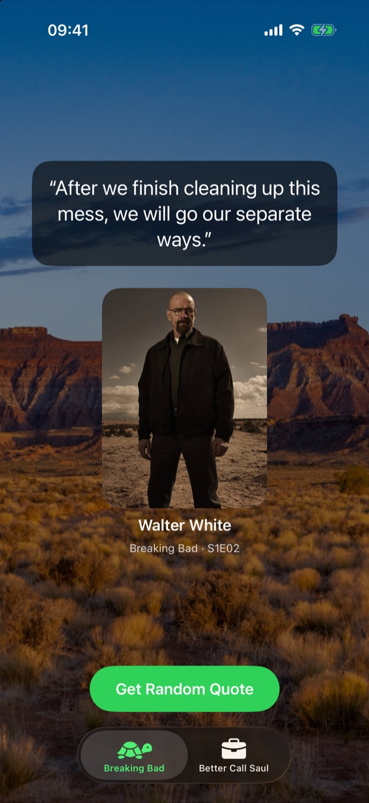
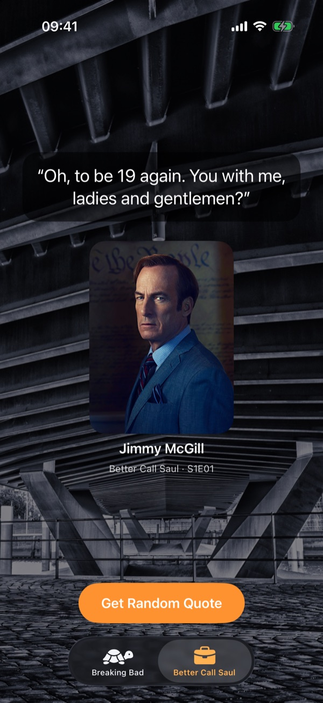
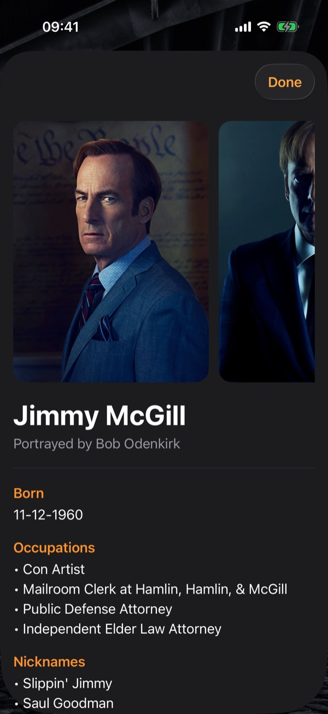

<p align="center">
  
</p>

<h1 align="center">BB Quotes</h1>

<p align="center">
  A SwiftUI app for fans of <i>Breaking Bad</i> and <i>Better Call Saul</i>: random quotes, the characters who said them, and how they died.
</p>

<p align="center">
  
  
  
</p>

<p align="center">
  
  &nbsp;
  
  &nbsp;
  
</p>

---

## Features

- **One tab per show**: Breaking Bad and Better Call Saul, each with its own artwork and accent color
- **Random quotes** loaded from a public REST API, with a new one on every tap
- **Character card** with the photo and name of who said the quote, plus the episode (e.g. `S1E03`)
- **Character details**: photo gallery, actor, birthday, occupations, nicknames and status
- **Death details** for characters who died: cause, what happened and their last words
- Loading and error states, and dark mode throughout
- Runs on iPhone, iPad, Mac and Apple Vision Pro from a single SwiftUI codebase

## Tech stack

| | |
|---|---|
| Language | Swift 6 (default `MainActor` isolation, approachable concurrency) |
| UI | SwiftUI: `TabView`/`Tab`, `AsyncImage`, sheets, scroll target behavior |
| State | Observation framework (`@Observable`) in an MVVM layout |
| Networking | `URLSession` with `async`/`await` |
| Data | `Codable` models mapping the API's `snake_case` keys |
| Platforms | iOS / iPadOS 26.5+, macOS 26.5+, visionOS 26.5+ |

## Architecture

```
bb_quotes/
├── bb_quotes.xcodeproj
├── docs/screenshots/
└── bb_quotes/
    ├── App/
    │   └── bb_quotesApp.swift       # App entry point
    ├── Models/
    │   ├── Show.swift               # The two shows: title, icon, artwork, accent color
    │   ├── Quote.swift
    │   ├── Character.swift
    │   └── Death.swift
    ├── Services/
    │   └── FetchService.swift       # REST client (quotes, characters, deaths)
    ├── ViewModels/
    │   └── QuoteViewModel.swift     # Loads a quote, its character and death; exposes status
    ├── Views/
    │   ├── ContentView.swift        # Root TabView
    │   ├── QuoteView.swift          # Quote + character card for one show
    │   └── CharacterView.swift      # Character and death details sheet
    ├── SampleData/                  # Sample JSON + decoder used by SwiftUI previews
    └── Resources/
        └── Assets.xcassets          # App icon and show artwork
```

When a tab appears (or the button is tapped), `QuoteViewModel` asks `FetchService` for a random quote from that show, then fetches the character who said it and, if they are dead, their death record. Each view switches on the view model's `status` to show a loading indicator, the result or an error.

## API

Data comes from the [Breaking Bad API](https://breaking-bad-api-six.vercel.app/api) (no key required):

| Endpoint | Used for |
|---|---|
| `GET /quotes/random?production=<show>` | A random quote from the selected show |
| `GET /characters?name=<name>` | The character who said it |
| `GET /deaths` | Death details, matched by character name |

## Getting started

1. Clone the repository:
   ```bash
   git clone https://github.com/filizzolalucca/bb_quotes.git
   ```
2. Open `bb_quotes.xcodeproj` in Xcode 26 or later.
3. Pick a simulator (or *My Mac*) and press **⌘R**.

> To run on a physical device, choose your own team under **Signing & Capabilities**.

## Possible next steps

- Cache quotes and images for offline use
- Unit tests for the models and the fetch service
- Share a quote as an image

## Disclaimer

This is a fan project made for learning and portfolio purposes. It is not affiliated with or endorsed by AMC or Sony Pictures Television. *Breaking Bad*, *Better Call Saul* and all related names, images and quotes belong to their respective owners.

## Author

**Lucca Filizzola** · [@filizzolalucca](https://github.com/filizzolalucca)
